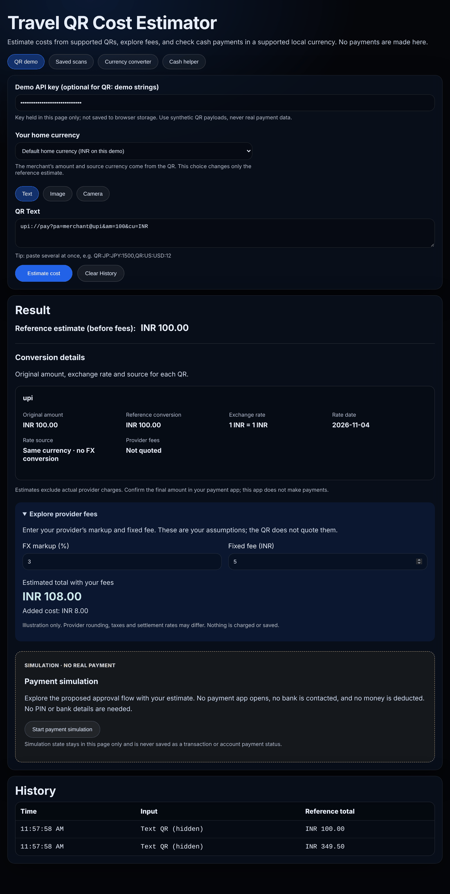
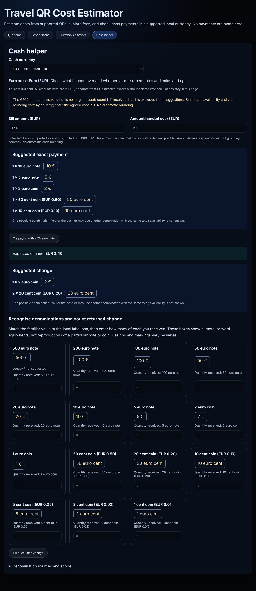
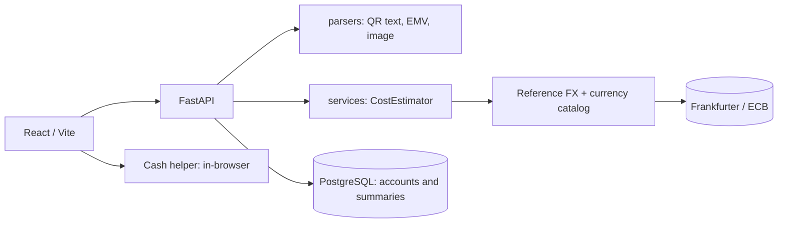

# Travel QR Cost Estimator

Scan a foreign payment QR and see what it costs in your home currency, with the exchange rate,
its date and its source. Add your bank's fees to see the real total, and check the change you
get back when paying cash.

**[Live demo](https://qr-payment-agent-demo.onrender.com/)** · React 19 · FastAPI · OpenCV · PostgreSQL · Docker

> Educational project using synthetic data. It never moves money, verifies merchants or quotes a final bank charge.



## Try it in 30 seconds

No key or sign-up needed for these. The free server may take a minute to wake up.

1. **QR demo:** paste `QR:JP:JPY:1500,QR:US:USD:12`, choose a home currency and select **Estimate cost**.
2. **Explore provider fees:** enter a 3% markup and a fixed fee to see the total with fees.
3. **Cash helper:** choose EUR, enter a bill of `17.60` and `20` handed over. Expected change: EUR 2.40.

UPI/EMV payloads, image uploads and camera photos use a private demo key. Contact the project owner for one.

## Features

- **Reads real QR formats:** amount-bearing UPI links and a validated subset of EMVCo merchant QR, from text, an uploaded image or a phone photo. Several QRs can be estimated at once.
- **Dated reference conversion** into any currency the reference provider currently lists, with rate, date and source shown for each QR.
- **Fee explorer:** your markup and fixed fee applied to the estimate. A clearly labelled payment simulation walks through a proposed approval flow.
- **Cash helper** for THB, USD, EUR, JPY, INR and AED: suggests notes and coins, shows local numerals (Thai, Devanagari, Arabic, Japanese) and checks returned change. Runs entirely in the browser.
- **Private accounts** (optional) that save scan summaries, never raw QR text or payee details.



## Technical highlights

- **EMV QR parsing:** TLV decoding with duplicate-tag, nested-template and mandatory-field checks plus CRC-16/CCITT-FALSE verification ([`src/parsers/emv.py`](src/parsers/emv.py)).
- **Exact money:** `Decimal` throughout, rounded to each currency's ISO 4217 minor unit (JPY 0, KWD 3). The cash helper does its arithmetic in integer minor units.
- **Honest FX:** two reference feeds with staleness checks; if both fail, the API returns 503 rather than an invented rate ([`src/services/fx.py`](src/services/fx.py)).
- **Security:** salted scrypt passwords, only SHA-256 digests of bearer tokens stored, parameterized SQL, per-visitor rate limits that a forged `X-Forwarded-For` header can't bypass, CSP and other security headers, and images decoded in memory with size and pixel limits.
- **CI on every pull request:** ruff, mypy, pytest (including real QR image decoding), account tests on SQLite and PostgreSQL, React lint/build/tests, npm audit, a Docker smoke test, a localhost load check and Playwright browser tests.

## Architecture



One Docker image builds the React app and serves it from FastAPI, so the UI and API share one origin. The hosted demo runs on Render's free tier with a Neon PostgreSQL database.

| Folder | Contents |
| --- | --- |
| `src/parsers` | Demo, UPI and EMV text parsing; QR image decoding |
| `src/services` | FX rates, currency catalog and the `CostEstimator` |
| `src/api` | FastAPI routes, accounts, rate limits and security headers |
| `web/src` | React app |
| `tests`, `web/tests`, `integration` | Unit/API tests, JS tests, browser and load smoke tests |

## Run locally

Requires Python 3.13 and Node.js 22.

```bash
python -m venv .venv && source .venv/bin/activate
pip install -r requirements-dev.txt
export QR_API_KEY=$(python -c "import secrets; print(secrets.token_urlsafe(32))")
uvicorn src.api.server:app --reload --port 8000

# in a second terminal
cd web && npm ci && npm run dev    # http://127.0.0.1:5173
```

Run the checks with `ruff check . && mypy && pytest`, and `npm test && npm run lint && npm run build` in `web/`.
[DEPLOYMENT.md](DEPLOYMENT.md) covers Windows commands, Docker and Render.

## Documentation

- [User guide](docs/USER_GUIDE.md): every workspace, supported inputs, configuration, privacy and limits
- [Architecture decisions](docs/DECISIONS.md): why the AI and risk features were removed, why money is `Decimal`, and more
- [Scope](docs/SCOPE.md) · [Demo script](docs/DEMO_GUIDE.md) · [Verification log](docs/VERIFICATION.md) · [Cash sources](docs/CASH_CURRENCIES.md) · [Payment provider research](docs/PAYMENT_FEASIBILITY.md)

## Limitations

This is a portfolio project, not a payment product. It has no merchant verification, real payments, provider fee quotes, email verification, password recovery or MFA. Free hosting can sleep and has no uptime guarantee. See the [user guide](docs/USER_GUIDE.md#remaining-limitations) for the full list.
