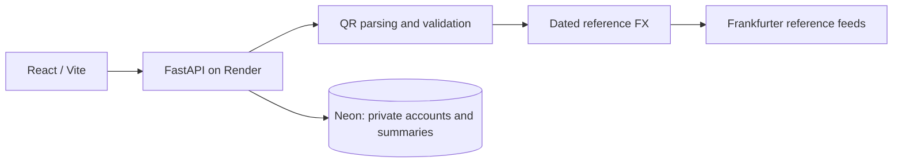

# Travel QR Cost Estimator

Understand a payment QR before opening your payment app: decode its amount, inspect a dated currency conversion, and explore how provider fees could affect the estimate.

**Educational prototype.** This app does not send money, verify merchants, detect fraud, or quote a final bank/card charge. Use synthetic data only.

[Hosted demo](https://qr-payment-agent-demo.onrender.com/) · [Setup and deployment](DEPLOYMENT.md) · [Verification report](docs/VERIFICATION.md) · [What belongs in the app](docs/SCOPE.md) · [International payment feasibility](docs/PAYMENT_FEASIBILITY.md)

## Features

- **Text, image and phone-photo input:** amount-bearing UPI URIs, demo QR strings, and a restricted subset of EMV merchant-presented QR.
- **QR home-currency selection:** preserve the QR’s original amount/currency and choose the currency for the estimate. Demo text, images, phone photos and private text scans support this; saved summaries retain the actual target currency.
- **Manual currency converter:** separate From and To blocks, an amount input, provider-supported currency dropdowns and a swap button. Choose any listed pair; a fresh reference rate must still be available.
- **Conversion details:** original amount, reference conversion, exchange rate, publication date and source for each QR, including multi-QR results.
- **Fee exploration:** enter a percentage markup and fixed fee to see their illustrative impact. These assumptions stay in the page and are not saved to account history.
- **Private accounts:** sign in, scan synthetic text QR data, and retrieve or clear only your own saved summaries.
- **Session handling:** tokens stay in React memory. Logout clears local account state; authenticated `401` responses return to sign-in and remove stale profile, history, results, and notices.

## Hosted deployment

The deployment verified on **24 October 2026** uses:

| Component | Deployment |
| --- | --- |
| Web app and API | Existing Render Free Docker service, `qr-payment-agent-demo` |
| Durable account database | Neon Free PostgreSQL project, `qr-payment-agent-db`, AWS Ohio |
| Public registration | Disabled: `QR_ALLOW_REGISTRATION=false` |
| Access | Developer key for the QR demo; separately provisioned private accounts for the account workspace |

No paid resources were provisioned during setup. Free-plan availability and quotas can change; inspect provider dashboards before creating resources or changing plans. Inactivity can cause cold starts. This is not an uptime or capacity guarantee.

The hosted app does **not** offer public account creation. Obtain private demo access from the project owner; credentials are never published in this repository.

## Architecture



Docker builds React and serves the frontend and API from one origin. Gradio and the CLI remain separate local interfaces. Redis is optional; the deployed architecture does not require a Redis resource.

## Supported inputs

| Input | Synthetic example / scope |
| --- | --- |
| Demo QR | `QR:JP:JPY:1500` |
| Multiple demo QRs | `QR:JP:JPY:1500,QR:US:USD:12`, or newline-separated values |
| Amount-bearing UPI | `upi://pay?pa=merchant@upi&am=100&cu=INR` |
| EMV merchant QR | Restricted amount-bearing subset with mandatory fields, TLV validation and CRC-16 checksum |
| Images in QR demo | PNG, JPEG or WebP; API limits: 3 MiB, 12 megapixels, and 5,000 pixels per dimension |

Account mode supports **text scans**; image uploads remain in the QR demo. Dynamic UPI without an amount and arbitrary national QR schemes are unsupported. An EMV checksum detects accidental modification; it does not verify merchant identity or certify payment-scheme compatibility.

## Scan a phone photo

In **QR demo**, enter the private demo key, choose **Your home currency**, then open **Camera** and select **Take QR photo**. Supported mobile browsers offer the rear camera; desktop or unsupported browsers may open a file picker. Capture a clear, synthetic QR and select **Estimate cost**. This is photo capture followed by image decoding, not continuous live scanning. No microphone or background camera stream is requested. Only the selected image is uploaded; the API deletes its temporary file after processing. PNG/JPEG/WebP, 3 MiB and existing dimension limits apply; use a lower-resolution photo when needed. **Image** and **Text** remain available if capture is unavailable or permission is declined.

## Try the result breakdown

For manual conversion, open **Currency converter**, enter the same private demo key used in the QR workspace, choose **From currency** and **To currency**, enter an amount and select **Convert**. Results show the reference rate, date and source. **Swap currencies** reverses the selected pair. Changing inputs clears the previous estimate.

The dropdown catalog is fetched from Frankfurter, cached for one hour and filtered to recent observations; historical-only entries and precious-metal/reference units are excluded. If the catalog or a fresh pair rate is unavailable, the app reports an error. This manual converter does not alter QR amounts, move money or save conversion history. QR scans preserve their encoded source currency. Select **Your home currency** to change the reference target; leaving it at default uses the configured home currency (INR on this deployment). Changing the selection clears the previous result, and each history row keeps its own currency.

1. Run locally, or use authorized private access to the hosted demo.
2. Scan `upi://pay?pa=merchant@upi&am=100&cu=INR`.
3. Inspect **Conversion details**: INR 100 original and reference amounts, a same-currency rate of 1, and the source/date of that conversion.
4. Open **Explore provider fees**. Enter 3% markup and INR 5 fixed fee.
5. The illustrated total is **INR 108**, including **INR 8** added cost.

Formula: `reference amount × (1 + markup / 100) + fixed fee`. For multiple QRs converted to the same currency, the percentage applies to the combined reference amount and the fixed fee is added **once**. This is not a per-transaction bank quote. Provider rounding, settlement rates and taxes may differ. Actual fees remain **not quoted**.

## Local setup

Use Python 3.13 and Node.js 22, matching CI.

1. Clone the repository and create/activate a Python virtual environment.
2. Run `python -m pip install -r requirements-api.txt`.
3. Generate a random development key: `python -c "import secrets; print(secrets.token_urlsafe(32))"`.
4. Set it as the backend's `QR_API_KEY` environment variable, then run:

   ```text
   python -m uvicorn src.api.server:app --host 127.0.0.1 --port 8000
   ```

5. In a second terminal, run `cd web`, `npm ci`, and `npm run dev`.
6. Open `http://127.0.0.1:5173/` and enter the same developer key in the QR demo.

See [DEPLOYMENT.md](DEPLOYMENT.md) for PowerShell and Docker instructions. Never commit keys or put secrets in `VITE_` variables: frontend build values are public.

For **local-only** account development, use an isolated SQLite file: `QR_DATABASE_URL=sqlite:////absolute/path/qr_accounts.sqlite`, with `QR_ALLOW_REGISTRATION=true`. Register synthetic users locally. Keep hosted registration disabled; SQLite on an ephemeral hosted filesystem is unsuitable for durable accounts.

For Gradio, install `requirements.txt` and run `python -m src.ui.app`. It calls the orchestrator directly without FastAPI authentication; keep it local. CLI: `python -m src.main`.

## Configuration

| Variable | Purpose |
| --- | --- |
| `QR_API_KEY` | Shared developer key; at least 24 characters; never publish it |
| `QR_DATABASE_URL` | SQLite URL locally, or TLS-enabled PostgreSQL URL for hosted accounts; server secret only |
| `QR_ALLOW_REGISTRATION` | Defaults to `false`; keep `false` on the hosted deployment |
| `PORT` | Container listening port; preserve the existing Render setting |
| `REDIS_URL` | Optional shared throttle counters; no new resource is required |
| `QR_CORS_ORIGINS` | Explicit frontend origins when using separate origins |
| `VITE_API_BASE` | Optional public API-origin override; empty for same-origin hosting; never a secret |

Store the Neon connection string privately in Render as `QR_DATABASE_URL`, never in source, screenshots or examples. Preserve `QR_API_KEY` and `PORT` when updating database settings. See the [Neon connection procedure](DEPLOYMENT.md#connecting-neon-postgresql-to-the-existing-render-service).

## Accounts, privacy and sessions

Account endpoints use bearer authentication independently of the shared demo key:

- `POST /api/account/register` — only when registration is explicitly enabled.
- `POST /api/account/login` and `POST /api/account/logout`.
- `GET /api/account/me` and `GET /api/account/history`.
- `POST /api/account/scan-text` and `POST /api/account/clear-history`.
- `GET /api/account/status` — configuration discovery only; it does **not** prove database connectivity.

Passwords use salted scrypt. Random bearer tokens expire after one hour; only their SHA-256 digests are stored. Logout removes the current token. Browser reload clears the local token but does not itself revoke the server token. Failed logout clears local credentials and warns that server revocation was not confirmed.

Queries are parameterized. Account history is scoped to the authenticated user and stores timestamp, currency and derived total, excluding raw QR text and payee identifiers. Full breakdowns and fee assumptions are not saved in summary history. Account emails, password hashes and token digests still require appropriate database protection.

The shared QR demo's history is temporary browser state. Backend conversational sessions expire after 30 minutes of inactivity and are bounded to 256 per process; these differ from database-backed account sessions. Neither developer keys nor account tokens are saved in browser local/session storage.

## Reference rates

The FX agent uses [Frankfurter](https://frankfurter.dev/) dated reference rates: a blended v2 feed with an ECB-backed v1 fallback. It validates positive rates and publication dates no more than seven days old, rejecting future dates and unavailable/stale data. Same-currency conversion uses rate 1 and the current date. Neither feed is an executed payment-provider rate.

`total_home` is the reference conversion **before fees**. Backend fee fields are placeholders with `fee_status: not_quoted`; the UI calculator is a separate user-entered scenario.

Risk scoring, the recipient-verification badge, AI commentary, raw-JSON displays and browser-locale guessing have been removed. The scan flow performs the requested reference conversion without an extra USD risk lookup or AI request. Existing account data is preserved; a retired database column remains only for schema compatibility. See [the scope decisions](docs/SCOPE.md) for why each feature was kept or removed.

## Verification and tests

The latest feature release passed six GitHub Actions jobs: Python tests, React build/lint/dependency audit, live FX checks, Docker API smoke tests, bounded localhost load checks, and Chromium browser regressions. See the [verification report](docs/VERIFICATION.md) for dated evidence and limits.

Live checks included PostgreSQL table/query access, private sign-in, persisted history after sign-out/reload/sign-in, cross-account visibility and clearing isolation, token deletion on logout, and rejection of deliberately expired test tokens. The stale signed-in display was fixed and verified on the hosted app.

Run local checks with the test dependencies installed:

```text
python -m pip install -r requirements-api.txt httpx==0.28.1 pytest==9.0.2 qrcode==8.2
python -m pytest tests/ -q
cd web
npm ci
npm run build
npm run lint
npm audit --audit-level=low
```

The [GitHub Actions workflows](.github/workflows/) include browser setup, a local synthetic account database and bounded load checks. `integration/load_smoke.py` refuses non-localhost targets and submits 20 synthetic scans across four workers. Its measurements are not hosting-capacity guarantees. Do not load-test the hosted Free service.

Manual conversion endpoints: `GET /api/currencies` returns currency codes and names; `POST /api/convert` requires the shared demo key and accepts `amount`, `from_currency` and `to_currency`. Amounts must be positive, no greater than 1,000,000,000,000 and have at most six decimal places. Reference results are rounded to two decimals; this is not provider-specific settlement rounding. Conversion requests are limited to 30/minute per client address using the existing best-effort limiter.

## Remaining limitations

- No email verification, password recovery, MFA, or mature session/device management. These were not included in the focused release.
- Shared demo keys are developer access control, not individual identity. Private accounts provide scoped demo data, not production financial-service authentication.
- Throttling is best-effort: login 6/minute, registration 4/minute and scans 30/minute by client address/route. In-process counters reset with the service and are not a complete abuse defense.
- No merchant verification, payment execution, provider fee integration, or authoritative fraud signals.
- Free hosting/database quotas, cold starts, retention and backup arrangements need operator review before broader use.
- No claim of a full penetration test, regulatory certification, global QR interoperability, or production readiness.

The project is ready for a controlled portfolio demonstration with synthetic data. Public registration remains disabled.
